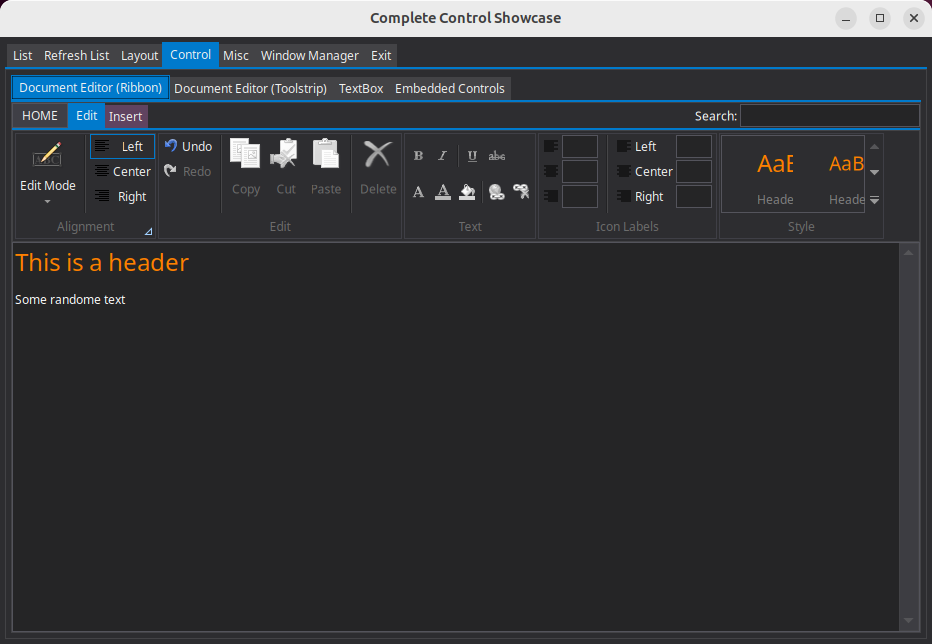

# wGac — Wayland Port of GacUI

[中文版](README_CN.md)

wGac implements the native GacUI platform layer for Linux Wayland using Wayland, Cairo, Pango, and XKBCommon.

## Prerequisites

The committed `Import/` and `Apps/` snapshots make a normal build independent of sibling source repositories. On Ubuntu, install the system build dependencies once with:

```bash
sudo ./build-prerequisites-ubuntu.sh
```

The script requires root privileges but never invokes `sudo` itself. It uses `apt-get` to update apt metadata and install the compiler, CMake, `pkg-config`, the required development packages, and the libdecor GTK runtime plugin. Review the script before running it if you need to audit system changes. On Debian or another Linux distribution, install the equivalent packages with that distribution's package manager.

The retained `WGacDialogService` implementation uses GIO, but current Wayland applications select `FakeDialogService`. Global shortcuts use GIO and require a desktop backend implementing the GlobalShortcuts portal; ordinary application dialogs do not require a portal.

`./build.sh` only configures and builds the project; it never downloads or installs dependencies. If CMake reports a missing compiler, `pkg-config`, or development module on Ubuntu, run `sudo ./build-prerequisites-ubuntu.sh` and then retry `./build.sh`.

Run applications from a Wayland desktop session with `WAYLAND_DISPLAY` and `XDG_RUNTIME_DIR` available.

Use a UTF-8 locale for Unicode filenames. Standard, hosted and remote renderer startup initializes `LC_CTYPE` from the environment before creating the native controller, matching the TUI provider. Date and number formatting still use the existing en-US locale implementation.

wGac requires libdecor and a real runtime decoration plugin at startup; it stops with a diagnostic instead of silently accepting libdecor's undecorated fallback. To make repeated switches between GacUI custom frames and platform frames safe on every compositor, wGac forces libdecor to provide its client-side platform frame even when server-side decorations are available. This libdecor frame is the native platform frame from GacUI's perspective and is distinct from GacUI's custom window template.

For maintenance work, keep the GacUI, Workflow, and Tools repositories beside wGac, or run `./syncOrg.sh`. `import.sh` reads GacUI framework snapshots, and `syncProj.sh` reads GacUI test resources and builds the Workflow and GacUI generators. The sibling Release repository is not a build or import dependency.

## Supported Platforms

- Windows implementation is released in [the Release repo](https://github.com/vczh-libraries/Release)
- Linux implementation is released in [the wGac repo](https://github.com/vczh-libraries/wGac)
- macOS implementation is released in [the iGac repo](https://github.com/vczh-libraries/iGac)
- HTML5 implementation is released in [the GacJS repo](https://github.com/vczh-libraries/GacJS)



.png)

## Project Structure

```text
wGac/
├── WGac/                              Wayland platform implementation
│   ├── Protocol/                      Committed Wayland protocol sources
│   ├── Renderers/                     Cairo/Pango GacUI renderer
│   ├── Services/                      Native platform and automation services
│   └── Wayland/                       Display, seat, and buffer integration
├── WGacShared/                        GacUI, wGac, and shared test libraries
├── WGacTest/                          Hello World app and native service tests
├── WGacFullControlTest/               Full Control Test, standard or hosted
├── WGacTuiControlTest/                Terminal Control Showcase using TuiSkin
├── WGacCppTestRvm/                    Remote View Model Test client
├── RemotingTest_Core/                Platform MiniHTTP Core with a local clipboard fallback
├── RemotingTest_Rendering_Wayland/    Native renderer for RemotingTest_Core
├── Apps/                              Synchronized resources and generated C++
├── Import/                            Imported GacUI amalgamated sources
├── Import-Test/                       Test-only GacUI remoting helper amalgamations
├── import.sh                          Refresh Import from sibling GacUI
├── GacBuild.sh                        Run upstream generators with full metadata
├── syncProj.sh                        Refresh and generate Apps and shared sources
├── syncOrg.sh                         Synchronize organization repositories, including wGac
├── build-prerequisites-ubuntu.sh      Install Ubuntu system build dependencies
├── build.sh                           Build all test targets
├── test.sh                            Launch one native test target
└── test_core.sh                       Launch the platform Core or local RVM requester and its host
```

`Import/` and `Import-Test/` must not be edited directly; framework fixes belong in GacUI, and Wayland compatibility fixes belong in wGac. This is a development rule; the generated files and directories retain owner write permissions. `Import-Test/` contains the dedicated neutral `Test.RemotingHelpers` pair; the stdio transport implementation comes from the matching `VlppOS.Linux.cpp` in `Import/`. These files are for platform test targets and are not part of the ordinary GacUI framework snapshot. Files under `Apps/*/Resources/` and `Apps/*/Source/` are synchronized or generated by `./syncProj.sh` and must not be edited directly.

## Synchronizing Dependencies

Synchronize the organization repositories, including this wGac checkout:

```bash
./syncOrg.sh
```

Refresh the imported framework snapshot:

```bash
./import.sh
```

This replaces `Import/` and `Import-Test/`, copies the ordinary framework files from `../GacUI/Import/` and `../GacUI/Release/`, adds the DarkSkin and TuiSkin release sources, moves the neutral `Test.RemotingHelpers` pair into `Import-Test/`, and keeps both snapshots writable by their owner. The imported `VlppOS.Linux.cpp` supplies the stdio transport implementation.

Refresh the Terminal Control Showcase, Full Control Test, Remote Protocol Test, and Remote View Model Test projects:

```bash
./syncProj.sh
```

This incrementally builds `<Workflow repo>/Tools/CppMerge`, `<GacUI repo>/Tools/GacGen` and `<GacUI repo>/Tools/GacBuild` through their existing native build helpers. It copies all four upstream resource trees and their seed C++ files, then invokes `<wGac repo>/GacBuild.sh -mode:GacGen` for each resource. GacGen stages `/P32` and `/P64`; GacBuild validates both outputs and uses CppMerge to merge matching files into `<wGac repo>/Apps/*/Source/`. This preserves upstream seed `USER_CONTENT`, embedded resources and `RemoteViewModelTestRpc.h/.cpp`. Generated reflection files remain present and excluded from targets using `VCZH_DEBUG_NO_REFLECTION`.

`GacBuild.sh` locates all three executables in the sibling GacUI and Workflow repositories and supplies explicit absolute paths to GacGen and CppMerge. It passes a temporary GacGen symlink without resolving it, so the adjacent `Metadata.txt` selects full `Reflection32.bin` and `Reflection64.bin` from `<GacUI repo>/Test/Resources/Metadata/`. Full metadata includes generated dialog types absent from the development tool's usual core-only metadata. The wrapper removes its temporary entry point on success or failure and returns the native tool's exit status. Maintenance uses the sibling Workflow and GacUI repositories; it does not require a Release checkout.

Synchronization adds the imported skin headers to each showcase's generated C++ includes: TuiSkin for TuiControlTest and DarkSkin for FullControlTest. FullControlTest's vertical tab rail uses DarkSkin templates and palette values directly.

After `syncProj.sh` builds the tools, the wrapper can also be used directly:

```bash
./GacBuild.sh -FileName path/to/GacUI.xml -Dump
./GacBuild.sh -mode:GacGen -FileName Apps/TuiControlTest/Resources/Resource.xml
```

The default GacBuild mode takes a driver XML for incremental resource discovery; `-Dump` only reports the plan. Put `-mode:GacGen` first to rebuild one resource, optionally with `-MappingFileName <mapping>`. XML and mapping paths remain relative to the caller's working directory, even when invoking the wrapper from elsewhere.

Inspect `<wGac repo>/Apps/*/Resources/GacBuild.log` and `<wGac repo>/Apps/*/Resources/Resource.xml.log/{x32,x64}/` for orchestration and compiler diagnostics, staged C++/RPC files, binary caches and `Deploy.xml` deployment lists. Staging artifacts are retained after success or failure and ignored by Git; the next synchronization replaces the copied resource trees. Generation, missing-artifact, merge and deployment failures stop synchronization with nonzero status.

The script also copies the shared TUI GuiMain from `<GacUI repo>/Test/GacUISrc/CppTest_Tui/Main.cpp` and refreshes the shared native-renderer and RVM entry points, the RVM initializer, and the shared FullControlTest skin-item and document helpers. The RVM entry point's shared automation argument header is copied to the committed root `<wGac repo>/SharedArguments.h`, so a fresh clone can build without sibling sources or temporary files. The standalone showcase uses those helpers to populate `SkinItems` and attach each editor's document events. Selected item actions refresh existing controls in both standard and hosted modes. MiniHTTP automation is part of the imported GacUI snapshot, while reusable remoting test helpers come from `<wGac repo>/Import-Test/`; neither is maintained as a local `<wGac repo>/WGacShared/Mini*.cpp` copy.

## Building

```bash
./build.sh
./build.sh --rebuild
```

The first command is incremental. `--rebuild` removes only the `build/` directory and performs a clean build. Dependency discovery remains in CMake; when an Ubuntu machine is missing the required system packages, run `sudo ./build-prerequisites-ubuntu.sh` once and retry the build.

CMake discards cached X11 header and library paths that no longer exist, such as paths into a deleted temporary sysroot, and searches again. The TUI clipboard requires `libx11-dev` and `libxfixes-dev`; install them through the prerequisite script if discovery fails.

The root CMake project uses C++23 and builds:

- `GacUI`, the imported GacUI framework.
- `WGac`, the Wayland platform layer.
- `WGacShared`, imported remoting test helpers shared by the test targets.
- `Test_HellWorld_Cpp`.
- `Test_FullControlTest`.
- `Test_CppTest_Rvm`.
- `WGacTui` and `Test_TuiControlTest`.
- `RemotingTest_Rendering_Wayland`.

Run the native service regressions after building:

`Test_ClipboardService` covers process-local text, rich document and image readback without a desktop input serial, and retirement of an unpublished copy when the compositor clears the selection. Ordinary native copy also publishes text/image formats to Wayland; rich document objects stay within the owning process.

```bash
./build/WGacTest/bin/Test_AsyncService /C
./build/WGacTest/bin/Test_ImageService /C
./build/WGacTest/bin/Test_ClipboardService /C
./build/WGacTest/bin/Test_GlobalShortcuts /C
./build/WGacTest/bin/Test_RenderingLifecycle /C
./build/WGacTest/bin/Test_ElementShapes /C
./build/WGacTest/bin/Test_RawElement /C
./build/WGacTest/bin/Test_RawElement /C --hosted
```

`Test_ElementShapes` uses the registered element renderers with offscreen Cairo surfaces. It checks rectangle, ellipse and rounded-rectangle fills, all four gradient directions, independent corner radii, border alignment, clipping, alpha, transforms and empty bounds. Renderer initialization requires a Wayland display connection.

`Test_RenderingLifecycle` requires an available Wayland display. It checks that resizing during a draw preserves the active Cairo buffer and that the next draw uses the resized pool. It also verifies that a delayed tooltip whose popup parent has no mapped role leaves the compositor connection usable. Native rendering discards an obsolete-sized frame and asks GacUI to render again. The test also inspects Wayland requests to ensure resizing commits geometry with a matching content buffer, including title/frame changes and resizing during a draw. wGac defers decoration and frame-callback commits while that buffer is pending, preventing resize feedback and window jitter.

`Test_RawElement` also requires Wayland. It checks the concrete raw factory in standard and hosted modes, Cairo clipping/state/path isolation with scale and offsets, interpretor transitions and exactly-once cleanup, fixed-data Clock/Touching pixels, and remote collection cleanup plus interpretor-only/data-only repaint. Native remote lifecycle checks run in standard mode, where the renderer owns a real native window.

These tests cover pending work during nested modal pumping and cancellation when a callback stops the service.
Image tests cover disabled grayscale rendering, all 256 alpha values, transparent compositing, cache reuse, and preservation of the original image. Disabled images use the same lightened grayscale conversion as Windows and macOS, with unchanged alpha. The converted surface is created on demand in an `INativeImageFrameCache` owned by the frame and shared by its renderers.
Global-shortcut tests use an isolated D-Bus session (`dbus-daemon`, installed by the prerequisite script) and a mock portal to cover application registration, early responses, modifier encoding, multiple shortcuts, activation on the UI thread, duplicate/invalid registrations, denial, cancellation and removal. They do not grant desktop permissions or replace live desktop verification.

## Custom Cairo Drawing, Raw Clock and Touching

`<Raw/>` is the recommended ownerdraw API for local, hosted and remote graphical applications. `GuiRawElementBase` exposes `Id`, `Interpretor`, `Data` and `SetInterpretorAndData` to C++ and Workflow. The application ID is independent of the optional registered painter name. TUI does not support raw drawing.

`<Raw>` creates `vl::presentation::elements::GuiWaylandElement`, defined in `<wGac repo>/WGac/Renderers/GuiWaylandElement.h`. Its `Rendering` event supplies the element, current logical bounds and a borrowed `cairo_t*`. Use that context only during the callback; never retain or destroy it or its surface. The provider has already applied clipping, hosted offsets and DPI scale. The renderer clips to the element bounds and preserves Cairo state and the current path around the event. Raw elements have no intrinsic minimum size.

`GuiWaylandElementRenderer` uses the common `GuiRawElementRendererBase`. Register factories through the active graphics resource manager after backend setup; hosted managers forward to the same native registry. Each renderer owns a fresh interpretor, which borrows its element and owns its detachable handler tokens. Replacing or clearing the name finalizes the old instance. An unknown name remains stored and installs nothing, with no retry after late registration. Independent manual handlers remain installed. Data-only, ID-only and identical assignments do not reinstall an unchanged name. The combined setter exposes both values before initialization. The concrete element finalizes while its event still exists, and base destruction does not finalize the instance twice. Target recreation preserves the interpretor.

Changing `Interpretor` or `Data` requests a repaint; changing only `Id` does not. Core batches the three strings into `ElementDesc_Raw`, alongside the numeric renderer ID. Core and renderer must use matching protocol snapshots. A descriptor assigns all three application strings before one `RawElementChanged` event; identical updates emit nothing. Interpretor-only and data-only updates repaint even without an owning composition. No native handles or pixel frames travel in this descriptor.

The clock face, hour marks and hands have a three-pixel black outline over the skin background. The Clock selects `Interpretor="FullControlTest::Clock"` and retains `Id="FullControlTest.Clock"`. Its Workflow timer supplies `HH:mm:ss`; painting never reads local time or starts another timer. Synchronization copies both portable `FullControlTestRawClockInterpretor.h/.cpp` files from `<GacUI repo>/Test/GacUISrc/Generated_FullControlTest/` into `<wGac repo>/WGacShared/` and adapts the framework include. The upstream `VCZH_MSVC` guards exclude Windows implementations on Linux. The separate, locally maintained `<wGac repo>/WGacShared/FullControlTestRawClockInterpretor_Wayland.cpp` implements Cairo primitives and an `IGuiPlugin`. Its controller-related load registers the factory before windows are constructed or remote messages are processed. Neither entry point registers Clock explicitly.

The portable base and Wayland plugin are direct sources, included exactly once in `Test_FullControlTest`, `RemotingTest_Rendering_Wayland` and `Test_RawElement`. Direct linking retains plugin registration even without referenced symbols. This application painter is outside the general platform library. The canonical renderer entry point and argument parser remain synchronized from GacUI.

Touching keeps `Id="FullControlTest.Touching"` and an empty interpretor. `<wGac repo>/WGacShared/FullControlTestRawElement.h/.cpp` provides `AttachFullControlTestTouchingElement`; the local window retains its attachment until before destruction. Its payload is `centerX,centerY,axisX,axisY,count`, followed by `count` triples of `pointId,x,y`. The axis rotates and uniformly scales a 160 by 100 SkyBlue rectangle with a black border. Contacts have orange (`#FF8800`) radius-16 rings. Bounds and clipping apply to both.

The locally maintained `<wGac repo>/WGacShared/FullControlTestRawElementRemote.h/.cpp` adapter attaches only Touching. It subscribes to installation/change/removal, enumerates existing elements for late attachment, and reconciles by element identity without duplicate handlers. ID changes remove obsolete attachments. Destroy the adapter before its renderer; retained disconnected pictures keep drawing until teardown. Native Wayland touch acquisition is unsupported, and the local/renderer automation adapters do not supply point-command state. Use fixed fixture payloads locally and synthetic `!PointDown` / `!PointUpdate` / `!PointUp` on Core automation for remote verification.

After upstream raw-contract changes, generate the owning GacUI release and metadata inputs before running `./import.sh`, `./syncProj.sh` and `./build.sh`. Imports do not repair stale inputs. Repeat synchronization and an incremental build, then run `./build.sh --rebuild` to verify reproducibility. Synchronization must preserve local Wayland helpers and direct-source inventories.

For focused application verification, run `./test.sh --app:fct`, then repeat with `--hosted`; visit only Misc / Raw Clock and Misc / Touching. Check advancing clock data and actual hands, resize, page switching, palette refresh, rectangle/contact pixels and clipping. Run the local showcase separately from Core because both use automation port 8888. For remote checks start `./test_core.sh --app:fct --protocol:minihttp`, then `./test.sh --app:renderer --port:8889`. Verify replacement and takeover with another renderer on 8890, including Clock name/data replay and Touching cleanup. Inspect Controls/Dom and IO state plus native screenshots or captured drawing buffers. Record unavailable display checks separately and stop all owned processes.

## Running and Automation

```bash
./test.sh --app:tui
./test.sh --app:simple
./test.sh --app:simple --unblock
./test.sh --app:fct
./test.sh --app:fct --hosted
./test.sh --app:fct --hosted --unblock
./test.sh --app:rvmt
./test.sh --app:rvmt --unblock
./test.sh --app:renderer
./test.sh --app:renderer --port:8890
./test.sh --app:renderer --unblock
./test.sh --app:core /FCT --unblock
./test.sh --app:core /RPT --fakeClipboard --denyClipboard
./test_core.sh --app:cpptest_rvm --protocol:minihttp --unblock
./test_core.sh --app:fct --protocol:minihttp
./test_core.sh --app:rpt --protocol:minihttp
./test_core.sh --app:rvmt --protocol:minihttp [--cli]
```

`--hosted` is valid only with `--app:fct`. `--port:<1-65535>` is valid only with `--app:renderer` and selects that renderer's automation listener; it does not change the `/MiniHttp` connection to Core on port 8888. The default renderer automation port is 8889. `--unblock` starts the selected executable in the background and prints its PID.

After `./build.sh`, `./test.sh --app:core` starts the local CMake target over MiniHTTP and defaults to FCT. Pass `/RPT` or `/RVMT` to select another application. Both endpoints enable clipboard sharing by default. Either accepts `--denyClipboard`, and Core accepts `--fakeClipboard` to select its in-memory fallback. Use `?remoteClipboard=false` to disable the browser offer. While sharing, Copy in the remote editor makes the selection available to other applications on the renderer machine. If either endpoint denies sharing, the headless Core uses its X11/XWayland selection or the selected fake clipboard.

`test_core.sh` accepts `--protocol:minihttp` and uses the same platform Core for `fct`, `rpt` and `rvmt`. In manual RVMT and `cpptest_rvm` modes it launches the local requester or Core, then builds and starts the sibling `RemotingTest_RvmHost`. An unblocked run prints both PIDs. With `--app:rvmt --cli` it prebuilds that host and Core starts it over stdio. Use `test.sh --app:core /RVMT` when GacJS supplies a network host, or pass a complete `/Cli:<command>` as one argument.

`test_core.sh --app:rvmt --protocol:minihttp --cli` passes a quoted native-host
command to Core. Core's `/Cli:<command>` option also accepts
`node "<absolute path to cli.js>"` as one argument and appends ` /Cli`.
Use the built script at `<GacJS repo>/Gaclib/website/rvmhost/lib/src/cli.js`
and `node` from PATH. Keep the shared `CppTest_Rvm/GuiMain.cpp` synchronized
from GacUI; renderer implementations are independent of this host launch mode.

The normal applications expose MiniHTTP automation on port 8888:

- Hello World: `/Automation/Test_HellWorld_Cpp`
- Full Control Test: `/Automation/Test_FullControlTest`
- Remote View Model Test: `/Automation/CppTest_Rvm`

For example:

```bash
curl http://localhost:8888/Automation/Test_HellWorld_Cpp/Controls
curl -H 'Content-Type: application/json; charset=utf8' \
    --data '!Exit' \
    http://localhost:8888/Automation/Test_HellWorld_Cpp/IO
```

Use `GET .../Controls` to inspect the control tree and `POST .../IO` or `POST .../IO/<windowId>` to send an IO command. A successful command returns `Queued`.

Always stop background test processes when verification is complete.

`--app:rvmt` waits for the matching Workflow RPC host. Start the client first, then run:

```bash
../GacUI/Test/Linux/RemotingTest_RvmHost/Bin/RemotingTest_RvmHost /MiniHttp
```

## Terminal Control Showcase

`./test.sh --app:tui` runs the hosted GacUI showcase directly in the current terminal. It requires interactive stdin/stdout and runs in the foreground; `--unblock`, `--hosted`, and `--port` are rejected. It has no HTTP automation endpoint. Start at 120x40 cells, also test 80x25, and follow [the TUI SOP](../GacUI/.github/Jobs/DebugTuiControlTestSop.md). Current results are in [TestMatrix_Tui.md](TestMatrix_Tui.md).

`WGac/TUI` composes `TuiControllerBase` with the existing wGac font/cursor, key-name and image services. Timers use the VlppOS owner-thread pump, and all windows and dialogs render in terminal cells. No Wayland surface or libdecor window is created. Font metrics remain `TuiFont`, size 1. The terminal determines displayed fonts and colors.

The TUI clipboard uses X11 selections (`libx11-dev` and `libxfixes-dev` are build prerequisites). On a Wayland desktop, XWayland supplies the bridge to other desktop applications; keep `DISPLAY` available. Without an X display, clipboard objects remain process-local. External transfers use UTF-8 text; rich documents and images remain available within the application. XFixes ownership notifications update clipboard-dependent commands. The app must remain running while another client reads its selection. Incoming incremental selections are supported; outgoing text must fit the X server's maximum request size.

Normal Hide, Close and Stop actions restore terminal input and output modes; terminal-tab close is not the normal shutdown test.

The TUI suppresses portal service diagnostics on the console so denied or failed global-shortcut requests cannot scroll its active frame. Native applications retain those diagnostics.

The provider initializes `LC_CTYPE` from the environment before starting workers, so native file/image services can decode Unicode filenames. Use a UTF-8 locale. The existing POSIX locale service retains en-US date/number formatting; translated showcase labels and dialogs still follow the selected application locale.

### Terminal input limitations

Local **Ctrl+Alt+Super+Q** requires a terminal that reports Super independently of Alt. GNOME Terminal 3.52.0 / VTE 0.76.0 discards Super and sends the same bytes as Ctrl+Alt+Q. This remains true in GNOME Terminal 3.58.0 / VTE 0.84.0 on Ubuntu 26.04.1: compositor-generated input produces `1b 11` for both chords. This limitation occurs when the terminal encodes input: GNOME/Wayland delivers Super to the focused terminal, but the TUI process receives only its output bytes. Native Wayland rendering receives the modifier directly for its own focused window.

Use [Kitty](https://sw.kovidgoyal.net/kitty/) for the local Super shortcut. Install it alongside GNOME Terminal, open a Kitty window, and run the existing application from the `wGac` directory:

```bash
./test.sh --app:tui
```

VlppOS automatically enables Kitty's keyboard protocol and decodes Super; no application code changes, desktop upgrade or special keyboard-protocol configuration are required. The [Linux verification record](TestMatrix_Tui.md) confirms Ctrl+Alt+Super+Q with both Super keys in Kitty 0.32.2 under GNOME Wayland/XWayland.

Desktop shortcuts and the remaining terminal restrictions are independent of Kitty's local Super support:

- **Ctrl+Alt+Super+Shift+F8** is a global shortcut with no local-key fallback. It uses the desktop portal independently of the terminal's keyboard encoding, so it also works in GNOME Terminal after portal approval. See [Global shortcuts](#global-shortcuts) for desktop requirements.
- Standard SGR mouse reports have no Super bit, so mouse `osSuper` remains false. Legacy terminal Meta continues to map to Alt.
- The requested keyboard mode does not report standalone modifier keys, so pressing Alt alone cannot show access-key overlays. Mouse and arrow-key menu navigation remain available.

## Native Remote Renderer

Start `./test.sh --app:core /RPT --unblock` (or `/FCT`), then connect the native renderer.

```bash
./test.sh --app:renderer
```

The core listens on port 8888. The Wayland renderer connects through `/MiniHttp` and, by default, exposes its DOM and renderer-side IO on port 8889 at:

```text
/Automation/RemotingTest_Rendering_Native
```

Renderer replacement can reuse port 8889 after the old renderer stops. For live takeover, keep the existing renderer on 8889 and start the new renderer with `--port:8890`, then use the same automation prefix on port 8890.

Follow [GacUI's native-renderer verification guide](../GacUI/.github/Jobs/DebugRemoteProtocolWithNativeRenderer.md) for the complete RPT/FCT, replacement, takeover, and cleanup workflow.

## Input Mapping

Native Wayland input uses the shared declarations from VlppOS. Mouse movement, initial hover,
buttons, double clicks and both wheel axes preserve Alt independently of Super.
Left/right brackets and shifted braces map to `KEY_LEFT_BRACKET` (`0xDB`) and
`KEY_RIGHT_BRACKET` (`0xDD`); key-name lookup uses `[` and `]`.

## Known Limitations

- `GuiInnerShadowElement` rendering is not implemented; the shadow samples on Misc / Elements remain blank.
- Terminal input has separate modifier and shortcut limitations; see [Terminal input limitations](#terminal-input-limitations) for the Kitty setup and remaining restrictions.
- Native Dialogs:
  - The native FileChooser portal is implemented for open and save dialogs.
  - Message box not implemented.
  - Color picker not implemented.
  - Font picker not implemented.
  - These are limitations of `WGacDialogService`; the Wayland implementation currently always uses GacUI's `FakeDialogService`, so applications do not invoke any native dialog.
- Wayland does not allow clients to position normal top-level windows globally; placement requests are compositor-dependent.
- libdecor has no platform-frame window-icon API, so `IconVisible` is unsupported and always reports `false`.
- libdecor cannot independently hide the maximize control. Its maximize affordance follows `SizeBox` (the frame's resize capability); `MaximizedBox` retains its requested value but cannot override that platform limitation.

## Global shortcuts

wGac registers global shortcuts through the [GlobalShortcuts portal](https://flatpak.github.io/xdg-desktop-portal/docs/doc-org.freedesktop.portal.GlobalShortcuts.html). Native and hosted Full Control Test use **Ctrl+Shift+Alt+Super+Q**; the TUI showcase uses **Ctrl+Alt+Super+Shift+F8**. Native remote renderers forward portal activations to their Core. These shortcuts can work while another application has focus.

GNOME supports this portal starting with [GNOME 48](https://release.gnome.org/48/developers/#global-shortcuts), including GNOME 50 on Ubuntu 26.04 LTS. wGac detects the portal at runtime; it does not gate support on an Ubuntu version. A missing portal or an unsupported key returns `NotSupported`. User approval and the final desktop binding are asynchronous: a returned registration ID reserves the request, and activation starts only after approval. The desktop may change the requested chord. Cancelling or denying approval leaves that registration inactive.

`<wGac repo>/test.sh` creates a hidden desktop entry in the current user's XDG application directory and sets `WGAC_APPLICATION_ID` to `org.gaclib.wGac.<app>`. This supplies the identity required for terminal-launched test executables through the [Registry portal](https://flatpak.github.io/xdg-desktop-portal/docs/doc-org.freedesktop.host.portal.Registry.html). Each test app has separate consent. Other applications launched from a terminal should install their own matching desktop entry and set this variable; applications with a desktop or sandbox identity may rely on portal identification without it.

On the first registration, GNOME can show **Add Keyboard Shortcuts** outside GacUI. Approve the intended shortcut there, then test it while another window has focus. This desktop consent dialog is not part of `FakeDialogService` or the MiniHTTP control tree. Removing a shortcut cancels its pending portal request and closes its session; stopping the process releases all its sessions. GNOME 50 can leave the consent window visible after cancellation; dismiss that stale window with **Cancel**. If the portal restarts, restart the app to register again.

### Ubuntu 26.04 review

The review on Ubuntu 26.04.1 / GNOME Shell 50.1 identifies **one newly enabled feature: global shortcuts**, shared by the native, hosted, TUI and remote-renderer paths. Other documented restrictions remain:

| Feature | Ubuntu 26.04 result |
| --- | --- |
| Local Super shortcuts in GNOME Terminal | Still loses Super with VTE 0.84.0; use a compatible terminal such as Kitty. |
| SGR mouse Super / standalone Alt overlays | Unchanged terminal protocol and requested keyboard-mode restrictions. |
| Native message, color and font dialogs | Still not implemented in `WGacDialogService`; app dialogs continue using `FakeDialogService`. The existing FileChooser portal is not a new feature. |
| Global positioning of normal Wayland windows | Still compositor-controlled; newer drag protocols do not provide arbitrary positioning. |
| Platform-frame icon / independent maximize button | libdecor 0.2.5 still has no corresponding APIs. |
| TUI locale and external rich clipboard | Existing provider restrictions; the desktop upgrade does not implement these paths. |

The previously listed title-drag bug no longer reproduces: compositor-delivered dragging of the raw native renderer preserves the pointer's offset from the window corner. The compositor move path was already implemented in wGac commit `96ec017`; this is a corrected historical note, not an additional feature supplied by Ubuntu 26.04. See [the verification record](TestMatrix_Tui.md#ubuntu-2604-review-2026-10-09) for build and live test results.
## Remote feature options and document files

The native renderer and portable core demo default to no feature injection. Pass
`/remoteDT`, `/remoteLocale` and `/remoteFS` independently to both processes, for
example `./test_core.sh --app:fct --protocol:minihttp --remoteDT --remoteLocale --remoteFS`
and `./test.sh --app:renderer --remoteDT --remoteLocale --remoteFS`. The shell translates double-dash options to slash switches, which are forwarded in foreground and `--unblock` modes. Renderer capabilities are
reevaluated after replacement. Missing DateTime/Locale capabilities use the core
predecessor; an enabled filesystem without renderer support exposes an empty `/`
root and never accesses core files.

For GacJS, start the same Core wrapper and open its HTTP entry with
`?remoteDT&remoteLocale&remoteFS&corehost=localhost`. The browser and Core opt in
independently. Browser files live in the page origin's persistent OPFS; use an
installed UTF-8 locale for Core-local Unicode paths. REFRESH preserves OPFS.
Use FCT for renderer replacement checks: refreshing a page with `rvmhost`
also removes its accepted view-model host, so that RVMT Core must be restarted.

The local entry point uses `<wGac repo>/Apps/FullControlTest/Source/FullControlTestEventHandlers.h/.cpp` to populate observable skin items
and attaches all four persistence events to each editor's own document viewer.
Private `.bin` files contain their image bytes; private save and RTF/HTML exports
complete synchronously, including remote stream close. Synchronize the framework,
resources and shared sources together after this protocol change.

## Choosing the remote Core host

`./test.sh --app:renderer --corehost:core.example.com` selects the destination; omitting `--corehost` defaults to localhost. The option is renderer-only, case-sensitive, nonempty and allowed once. Both foreground and `--unblock` branches forward one quoted `/corehost:<host>` argument. The native entry point uses the canonical GacUI parser and accepts DNS hostnames, IPv4 and IPv6 addresses (optionally bracketed), without a URL, path or separate port. Invalid or duplicate native arguments are rejected before transports start.

```bash
./test.sh --app:renderer --corehost:core.example.com --port:8889
./test.sh --app:renderer --corehost:::1 --port:8890 --unblock
```

Native renderers here use `/MiniHttp`; `/Pipe` and `/Http` are Windows transports. Protocol TCP port is always 8888. `--port` changes only local renderer automation, default 8889, and can be combined with destination and injection options. The local Core/requester launchers need no destination option. A manually launched `RemotingTest_RvmHost /MiniHttp /corehost:core.example.com` connects to Core `/RVMT` or a requester server; its local `/Cli` mode rejects an explicit host.

Keep SharedArguments and renderer GuiMain synchronized from GacUI, and maintain the platform Main.cpp separately. Socket destinations are unbracketed IPv6; HTTP authorities add brackets. Native listeners use wildcard interfaces; network reachability still depends on the host environment. Same-machine hostname checks do not verify another computer.
The Linux GacUI target links liburing and glibc libanl for asynchronous DNS resolution.

## Popup owner lifecycle

`WGacNativeWindow::Hide` in `<wGac repo>/WGac/WGacNativeWindow.cpp` runs the same cancellable `BeforeClosing` and accepted `AfterClosing` sequence for hide and close. Shared GacUI uses `AfterClosing` to dismiss explicitly owned tooltip, popup and menu descendants before the owner becomes invisible. `HideInternal` only tears down native roles and publishes `Closed`; requested close sets the existing closed state without repeating the callbacks. Already hidden popups do not publish another close sequence.

Compositor dismissal and ancestor xdg-role teardown are mandatory: they ignore cancellation but still publish accepted-close notifications before native teardown. The native child scan is restarted after each child closes, since shared `GuiPopup::Closed` detaches its parent. Descendant roles disappear first. Keep this native role rule separate from GacUI's explicit control-relative ownership policy.

## Showcase skin items and TUI document files

The synchronization script copies `<GacUI repo>/Test/GacUISrc/SharedDocumentEditor.h/.cpp` into both showcase source folders and `<GacUI repo>/Test/GacUISrc/Generated_TuiControlTest/TuiControlTestEventHandlers.h/.cpp` into TuiControlTest. The TUI target explicitly compiles both helpers. FullControlTest compiles SharedDocumentEditor alongside its existing native helper through the generated-source inventory. Native composition populates the observable skin-item collections before showing each window. The repeated radios invoke item-owned actions and queue a single theme refresh, preserving selected identity.

TUI private load/save and RTF/HTML export use the common native formats. Image runs become embedded labels while displayed and return to image runs for serialization. File labels retain their path; binary/memory images display `[Image, width x height]`. Files embed image data and preserve unused style definitions. Regenerate both showcase resources when updating these helpers, then follow `<GacUI repo>/.github/Jobs/DebugTuiControlTestSop.md` for fresh-process round trips and normal shutdown.
